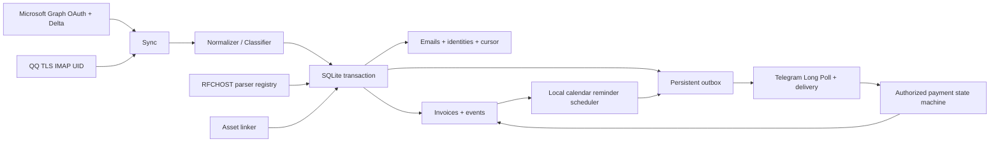

# Architecture v1 — frozen contract baseline

Modular monolith, one process, SQLite, Go 1.27, 1–10 independently authorized accounts. Repository was empty apart from AGENT.md at audit; original rules are preserved. No historical application or dependencies existed. Root orchestrator owns core, dependencies, this documentation and integration.

## Boundaries and consistency

MailSource yields core.NormalizedEmail, never SDK types. Provider performs bounded paging and returns a candidate next cursor. Sync serializes each account, normalizes and classifies, invokes parser, then writes email, invoice/assets, delivery and cursor in one Store.Transaction. No cursor advances after a failed write. Page replay is safe. One account failure does not stop others. Folder discovery initially enables Inbox only; explicit stored folder choices control additional incoming folders.

Initial BaselineAt is fixed and persisted before fetching. The initial full listing builds remote cursor, but only email ReceivedAt >= BaselineAt-24h gets an outbox. Old discovered messages are marked historical, stored without notifications or active invoices. Messages arriving while paging are included in baseline/delta catch-up and deduped. Graph per-folder next/delta links and IMAP bounded UID snapshot prevent holes. A new folder or changed UIDVALIDITY safely rebuilds that folder's baseline without replaying prior known mail.

All incoming monitored mail is persisted and delivered. Classification cannot suppress notifications. Valid invoices use one enhanced delivery with source-email access. Parsing failures retain diagnostic reasons; only sufficiently validated invoices enter PENDING_CONFIRMATION. REVIEW_REQUIRED never receives daily reminders. Merchant recognition is descriptive, not proof of authenticity; this application never pays a vendor.

Outbox lease claim is persisted. Ambiguous network sends become UNKNOWN and retry: at least once, best-effort deduplication, never Telegram exactly once. Per-part Telegram message IDs are retained where possible; restart may duplicate a message after an ambiguous response. Reminder unique(invoice_id, reminder_date), persistent initial-notification day, and pre-send status recheck prevent duplicate tasks and most stale reminders. An already in-flight external send cannot be recalled atomically with a local payment transaction; document this practical limit.

Dates are validated calendar strings; instants use UTC. Asia/Taipei is default scheduler zone; local day difference uses calendar dates, not elapsed local hours through DST. Money is signed integer minor currency units, with explicit currency and nullable optional amounts. Credit is not account balance. Paid means manual user declaration only.

Security: AES-256-GCM credentials and secure-session payloads, external key, state + PKCE, atomic expiring one-time sessions, TLS verification, whitelist user AND chat checks, parameterized SQL, escaped Telegram HTML, untrusted HTML converted to text, fixed safe vendor URL host. No automatic attachment downloads. No raw secret/token/body logging. Setup pages use HTTPS bearer links, no-referrer, no-cache, CSP and one-time POST; never ask for credentials in chat.

## Risks and required external validation

Live Microsoft app registration, QQ IMAP authorization and Telegram bot/chat credentials are external dependencies. Automated tests use HTTP/IMAP mocks without secrets. Deployment uses native Linux binaries from GitHub Releases with systemd; the installer preserves configuration, database and encryption keys on upgrades. IMAP library is v2 beta; pinned and exercised with a fake server. Dependency versions verified using Go proxy metadata on 2026-11-15; all selected versions are locked in go.mod/go.sum.

Sources: [Graph immutable IDs](https://learn.microsoft.com/en-us/graph/outlook-immutable-id), [folder delta](https://learn.microsoft.com/en-us/graph/delta-query-messages), [OAuth code flow](https://learn.microsoft.com/en-us/entra/identity-platform/v2-oauth2-auth-code-flow), [Telegram Bot API](https://core.telegram.org/bots/api), [SQLite driver](https://pkg.go.dev/modernc.org/sqlite), [IMAP library](https://pkg.go.dev/github.com/emersion/go-imap/v2/imapclient).
