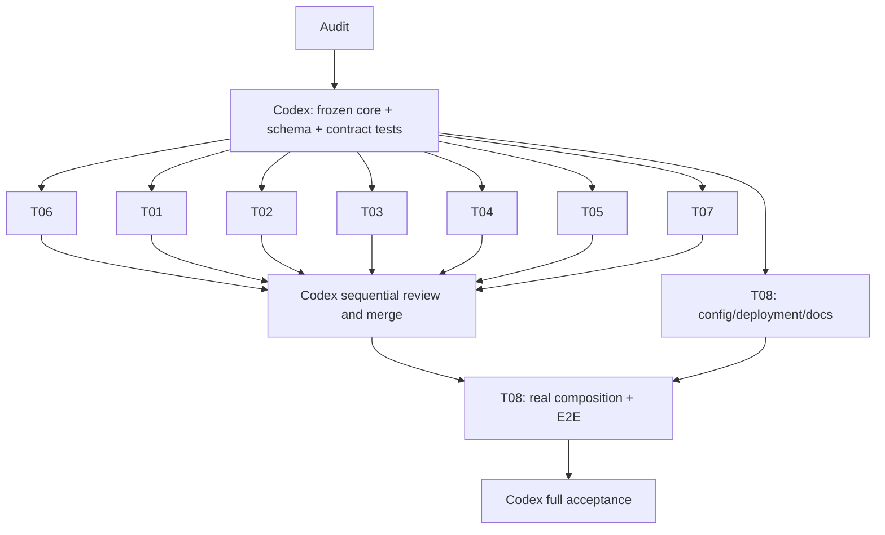

# Task DAG and ownership

Exactly eight independent work packages; no shared write ownership. Workers 01–07 depend only on frozen core; T08 config/deployment independent, final wiring serial. Initial phase modules test with repository/provider fakes. Estimated timings are planning estimates, not completion promises. Root orchestrator reviews every module and owns integration tests/fixes outside worker ownership after acceptance.

| Task | Worker | Goal | Ownership | Dependencies | Estimate | Acceptance | Parallel condition |
|---|---|---|---|---|---|---|---|
| T01 | Claude Code | Microsoft OAuth PKCE, refresh, Graph v1.0 immutable message IDs and per-folder delta | internal/providers/microsoft, internal/httpserver/oauth | frozen-core (T08 final: T01–T07) | 12–18 files; 20+ tests; 25–30 min | spec §5 | contract tests green; T08 stage B after merges |
| T02 | Claude Code | QQ TLS IMAP UID synchronization and one-time HTTPS credential setup | internal/providers/imap, internal/providers/qq | frozen-core (T08 final: T01–T07) | 10–15 files; 18+ tests; 25–30 min | spec §5 | contract tests green; T08 stage B after merges |
| T03 | Claude Code | Atomic multi-account pipeline with first-sync baseline, normalization, dedup and durable notifications | internal/sync, internal/mailproc | frozen-core (T08 final: T01–T07) | 8–12 files; 18+ tests; 20–30 min | spec §5 | contract tests green; T08 stage B after merges |
| T04 | Claude Code | RFCHOST invoice registry, strict integer money validation and real fixtures | internal/invoice/parser | frozen-core (T08 final: T01–T07) | 8–12 files; 25+ tests; 25–30 min | spec §5 | contract tests green; T08 stage B after merges |
| T05 | Claude Code | Authorized invoice payment state machine, persistent local-date reminders and safe VPS asset linkage | internal/invoice/lifecycle, internal/reminder, internal/assets | frozen-core (T08 final: T01–T07) | 10–14 files; 20+ tests; 20–30 min | spec §5 | contract tests green; T08 stage B after merges |
| T06 | Claude Code | SQLite repositories, migrations, transactional state and AES-256-GCM persistent secrets | internal/storage | frozen-core (T08 final: T01–T07) | 14–20 files; 25+ tests; 30 min | spec §5 | contract tests green; T08 stage B after merges |
| T07 | Claude Code | Telegram long polling, complete mail delivery, authorized commands and payment confirmation interactions | internal/telegram | frozen-core (T08 final: T01–T07) | 14–20 files; 22+ tests; 25–30 min | spec §5 | contract tests green; T08 stage B after merges |
| T08 | Claude Code | Runtime composition, strict config, Debian/Docker deployment and cross-module acceptance | internal/app, internal/httpserver/server, cmd, deployments, tests/e2e, docs/setup, docs/operations, README.md, .env.example | frozen-core (T08 final: T01–T07) | 16–24 files; 15+ tests plus full E2E; 25–30 min + integration | spec §5 | contract tests green; T08 stage B after merges |

Root go.mod/go.sum/core/global docs are Codex-only. LESSONS.md append reporting exception merged manually. Branches use explicit requested task/Txx naming. Worktrees created by orchestrator outside Claude sandbox at sibling .worktrees to satisfy user naming/isolation; native worktree creates incompatible branch/path conventions. CLI calibration uses default configured model (no override), Herdr interactive terminal per explicit user/global instructions.
