# Task DAG and ownership

```mermaid
flowchart TD
 Audit --> Core[Codex: frozen core + schema + contract tests]
 Core --> T01
 Core --> T02
 Core --> T03
 Core --> T04
 Core --> T05
 Core --> T06
 Core --> T07
 Core --> T08A[T08: config/deployment/docs]
 T06 --> Merge[Codex sequential review and merge]
 T01 --> Merge
 T02 --> Merge
 T03 --> Merge
 T04 --> Merge
 T05 --> Merge
 T07 --> Merge
 Merge --> T08B[T08: real composition + E2E]
 T08A --> T08B
 T08B --> Accept[Codex full acceptance]
 Accept --> T09[T09: frozen manual reminder contract]
 T09 --> T10
 T09 --> T11
 T09 --> T12
 T10 --> T13[T13: application integration]
 T11 --> T13
 T12 --> T13
 T13 --> Accept2[Codex manual reminder acceptance]
```

The manual-reminder phase is a second, additive wave. T09 is the only lane allowed to touch `internal/core`: it freezes the contract and writes the T10–T13 specs. T10, T11 and T12 are mutually independent and may run in parallel against that frozen core; T13 composes them and runs last.

Exactly eight independent work packages; no shared write ownership. Workers 01–07 depend only on frozen core; T08 config/deployment independent, final wiring serial. Initial phase modules test with repository/provider fakes. Estimated timings are planning estimates, not completion promises. Root orchestrator reviews every module and owns integration tests/fixes outside worker ownership after acceptance.

| Task | Worker | Goal | Ownership | Dependencies | Estimate | Acceptance | Parallel condition |
|---|---|---|---|---|---|---|---|
| T01 | Claude Code | Microsoft OAuth PKCE, refresh, Graph v1.0 immutable message IDs and per-folder delta | internal/providers/microsoft, internal/httpserver/oauth | frozen-core (T08 final: T01–T07) | 12–18 files; 20+ tests; 25–30 min | spec §5 | contract tests green; T08 stage B after merges |
| T02 | Claude Code | QQ TLS IMAP UID synchronization and one-time HTTPS credential setup | internal/providers/imap, internal/providers/qq | frozen-core (T08 final: T01–T07) | 10–15 files; 18+ tests; 25–30 min | spec §5 | contract tests green; T08 stage B after merges |
| T03 | Claude Code | Atomic multi-account pipeline with first-sync baseline, normalization, dedup and durable notifications | internal/sync, internal/mailproc | frozen-core (T08 final: T01–T07) | 8–12 files; 18+ tests; 20–30 min | spec §5 | contract tests green; T08 stage B after merges |
| T04 | Claude Code | RFCHOST invoice registry, strict integer money validation and real fixtures | internal/invoice/parser | frozen-core (T08 final: T01–T07) | 8–12 files; 25+ tests; 25–30 min | spec §5 | contract tests green; T08 stage B after merges |
| T05 | Claude Code | Authorized invoice payment state machine, persistent local-date reminders and safe VPS asset linkage | internal/invoice/lifecycle, internal/reminder, internal/assets | frozen-core (T08 final: T01–T07) | 10–14 files; 20+ tests; 20–30 min | spec §5 | contract tests green; T08 stage B after merges |
| T06 | Claude Code | SQLite repositories, migrations, transactional state and AES-256-GCM persistent secrets | internal/storage | frozen-core (T08 final: T01–T07) | 14–20 files; 25+ tests; 30 min | spec §5 | contract tests green; T08 stage B after merges |
| T07 | Claude Code | Telegram long polling, complete mail delivery, authorized commands and payment confirmation interactions | internal/telegram | frozen-core (T08 final: T01–T07) | 14–20 files; 22+ tests; 25–30 min | spec §5 | contract tests green; T08 stage B after merges |
| T08 | Claude Code | Runtime composition, strict config, Debian/Docker deployment and cross-module acceptance | internal/app, internal/httpserver/server, cmd, deployments, tests/e2e, docs/setup, docs/operations, README.md, .env.example | frozen-core (T08 final: T01–T07) | 16–24 files; 15+ tests plus full E2E; 25–30 min + integration | spec §5 | contract tests green; T08 stage B after merges |
| T09 | Claude Code | Freeze the additive manual-reminder contract and write the T10–T13 specs | internal/core, docs/architecture.md, docs/contracts.md, docs/database-schema.md, docs/task-plan.md, docs/tasks/T10–T13.md | T08 accepted | 8–12 files; 3–5 tests; 20–30 min | T09 §5: gofmt clean, build/vet/test green, diff inside allowlist | only lane allowed to touch internal/core |
| T10 | Claude Code | SQLite manual-reminder repositories, migration 0002 and outbox mirror | internal/storage/migrations/0002_manual_reminders.sql, internal/storage/manual.go, internal/storage/manual_test.go, internal/storage/outbox.go, internal/storage/outbox_test.go | T09 | 5 files; 15+ tests; 30 min | T10 §5 | parallel with T11/T12 |
| T11 | Claude Code | Manual recurrence, occurrence and scheduler domain | internal/reminder/manual/** | T09 | 6–9 files; 20+ tests; 30 min | T11 §5 | parallel with T10/T12 |
| T12 | Claude Code | Telegram wizard, commands, callbacks and manual rendering | internal/telegram/** | T09 | 8–12 files; 20+ tests; 30 min | T12 §5 | parallel with T10/T11 |
| T13 | Claude Code | Wire manual service/scheduler, MANUAL_* config, bot and E2E | internal/app/**, .env.example, README.md, docs/setup/telegram.md, tests/e2e/** | T10, T11, T12 | 6–10 files; 3+ tests; 30 min | T13 §5 | serial, after T10–T12 merge |

Root go.mod/go.sum/core/global docs are Codex-only. LESSONS.md append reporting exception merged manually. Branches use explicit requested task/Txx naming. Worktrees created by orchestrator outside Claude sandbox at sibling .worktrees to satisfy user naming/isolation; native worktree creates incompatible branch/path conventions. CLI calibration uses default configured model (no override), Herdr interactive terminal per explicit user/global instructions.
